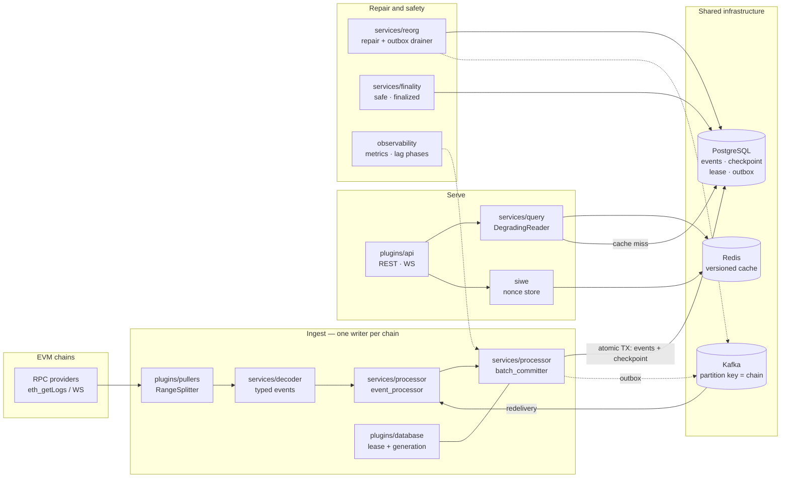

# ChainPulse

[](https://github.com/rtcdance/chainpulse/actions/workflows/ci.yml)
[](https://github.com/rtcdance/chainpulse/actions/workflows/test.yml)
[](https://github.com/rtcdance/chainpulse/actions/workflows/coverage.yml)
[](https://github.com/rtcdance/chainpulse/actions/workflows/release.yml)
[](https://github.com/rtcdance/chainpulse/actions/workflows/deploy.yml)
[](https://go.dev/)
[](LICENSE)

ChainPulse monitors and indexes blockchain events in real time. Track
transactions, detect chain reorganizations, inspect dead-letter queues,
and debug event processing across Ethereum and other chains — from a
single dashboard.

**What it is:** a Web3 Go backend that indexes EVM events — PostgreSQL
persistence, Kafka redelivery, a Redis cache and a query API — built around the
correctness problems that make indexing hard: reorgs that rewrite history,
at-least-once delivery, and finality that differs by chain.

**What it is not:** a bridge, an MEV or account-abstraction implementation, or a
multi-chain production deployment. The widest thing exercised is a two-chain
isolation test and a single-chain load path. It also has **no gRPC API**: there
is a `.proto` with message definitions and a protocol detector that can
*recognise* gRPC traffic, but no generated code, service definition, server or
client, so gRPC is neither served nor consumed.

See the [English project summary](docs/project/2026-10-13-english-summary.md) for
the evidenced results, the support boundary, and the design decisions
([ADRs](docs/adr/README.md)). The per-capability detail — what is verified, what
exists but is unverified, and what is absent — is in
[SUPPORT_MATRIX.md](docs/project/SUPPORT_MATRIX.md); it names the test or lane
behind every verified row.

## 5-Minute Happy Path

See blockchain events indexed and queried in under 5 minutes:

```bash
# 1. Start the in-memory playground (no Docker, no DB)
go run cmd/playground/main.go

# 2. Generate mock blockchain events
curl http://localhost:9099/generate

# 3. View the events
curl http://localhost:9099/events | head -100

# 4. Subscribe to live events via SSE
curl http://localhost:9099/subscribe?topic=events

# 5. Open the web UI
open http://localhost:9099
```

No Docker, no database, no config file. The playground runs entirely
in-memory with mock data — perfect for learning the Web3 to Go event flow.

## 🚀 Quick Start

### 🎮 Playground (Zero Setup, 10 Seconds)

No Docker, no database, no config needed:

```bash
go run cmd/playground/main.go
# → http://localhost:PORT/events — see mock blockchain events instantly
# → http://localhost:PORT/generate — create new events
```

The playground runs entirely in-memory with mock data. Perfect for learning
the Web3 → Go event flow without any infrastructure.

### 3-Step Docker Launch

```bash
# 1. Create environment configuration
cp docker/.env.example docker/.env
# Edit docker/.env — set POSTGRES_PASSWORD, JWT_SECRET, etc.

# 2a. Quickstart (1 chain + essential infra, recommended for development)
docker compose -f docker/docker-compose.quickstart.yml up -d

# 2b. Full stack (7 EVM chains (config) + Solana/Cosmos adapters + full observability)
docker compose -f docker/docker-compose.yml up -d

# 3. Verify it's running
curl http://localhost:8080/health
```

### Launch with Dashboard UI

```bash
docker compose -f docker/docker-compose.yml -f docker/docker-compose.with-ui.yml up -d
# Open http://localhost:3000 to see the ChainPulse dashboard
```

### Prerequisites

- Go 1.26+
- Docker & Docker Compose (for full stack)
- PostgreSQL, Redis, Kafka (optional — playground mode needs none)

### Local Development

```bash
# Start infrastructure only
docker compose -f docker/docker-compose.dev.yml up -d

# Run monolithic mode
go run cmd/monolithic/chainpulse/main.go
```

### Most Used Commands

```bash
make test              # Run unit + integration tests
make lint              # Code quality check
make build             # Build all binaries
go run cmd/playground/ # In-memory playground (fastest feedback)
```

> See [scripts/README.md](scripts/README.md) for the full list of 50+
> automation and verification scripts.

## 📚 Documentation

See [docs/README.md](docs/README.md) for complete documentation index.

### Quick Links

- **[Runnable App](docs/project/RUNNABLE_APP.md)** - Current runbook for the minimum viable blueprint-aligned app
- **[Security Baseline](docs/project/SECURITY_BASELINE.md)** - Overview of the current optional four-service security posture
- **[Security Rollout](docs/project/SECURITY_ROLLOUT.md)** - Incremental enablement and rollback guidance for the opt-in four-service security surface
- **[Project Docs](docs/project/README.md)** - Project-level guardrails and operational guidance
- **[Developer Guide](docs/guides/DEVELOPER_GUIDE.md)** - Development setup and guidelines
- **[Deployment Guide](docs/guides/DEPLOYMENT_GUIDE.md)** - Deployment procedures
- **[API Documentation](docs/guides/API_DOCUMENTATION.md)** - REST and WebSocket APIs
- **[Operations Guide](docs/guides/OPERATIONS_GUIDE.md)** - Monitoring and maintenance

## 🏗️ Project Structure

```
chainpulse/
├── cmd/                   # Application entrypoints
│   ├── monolithic/        # Monolithic mode
│   ├── microservices/     # Microservice mode
│   │   ├── api-gateway/
│   │   ├── api-service/
│   │   ├── event-processor/
│   │   └── puller/
│   └── playground/        # In-memory playground
├── contracts/             # Foundry: EventEmitter/SwapEmitter + vendored forge-std
├── docker/                # Compose stacks (dev, microservices, e2e, acceptance)
├── docs/                  # Documentation
│   ├── adr/               # Architecture decision records
│   ├── architecture/      # Architecture notes and diagrams
│   ├── deployment/        # Go-live and operations runbooks
│   ├── guides/            # Developer and operator guides
│   ├── operations/        # Governance and policy docs
│   ├── project/           # Project guardrails and per-task records
│   └── specs/             # Design records (the delivery plan lives here)
├── examples/              # Runnable examples
├── frontend/              # Dashboard/UI
├── k8s/                   # Kubernetes manifests
├── migrations/            # PostgreSQL migrations, applied in filename order
├── monitoring/            # Prometheus, Grafana, Loki, Alertmanager assets
├── pkg/                   # Go packages
│   ├── core/              # Foundation interfaces and types (DDD)
│   ├── ports/             # Hexagonal ports (core aliases these)
│   ├── domain/            # Domain models
│   ├── application/       # Use cases and orchestration
│   ├── plugins/           # Plugin implementations
│   │   ├── api/           # API plugins (REST, GraphQL, WebSocket)
│   │   ├── cache/         # Caching implementations
│   │   ├── database/      # Database drivers (PostgreSQL, in-memory)
│   │   ├── mq/            # Message queue implementations (Kafka)
│   │   └── pullers/       # Data collection (HTTPS, WebSocket)
│   ├── services/          # Business logic (indexing, processor, reorg, finality, query)
│   ├── evm/               # EVM typed event decoding
│   ├── siwe/              # Sign-In With Ethereum and the nonce store
│   ├── infrastructure/    # Infrastructure utilities
│   ├── integrations/      # External integrations (ERC20, Uniswap)
│   └── observability/     # Metrics, tracing, health
├── scripts/               # Automation and verification (see scripts/README.md)
│   └── acceptance/        # verify-tests, collect-evidence, bench-gate, dep-approval-gate
└── test/                  # Test suites
    ├── acceptance/        # Cross-cutting acceptance tests + tools/
    ├── benchmarks/        # Micro-benchmark baselines
    ├── contracts/         # Adapter contract suites
    ├── e2e/               # End-to-end tests
    ├── fixtures/          # Committed corpora (e.g. the Uniswap V3 Swap fixture)
    ├── integration/       # Integration tests
    ├── migration/         # Migration tests
    └── performance/       # Performance tests
```

## 📊 Architecture

### System Overview

The diagram below is the indexing path as the code actually implements it
(PostgreSQL + Kafka + Redis + EVM). The widest things exercised today are a
two-chain isolation test and a single-chain load path — not a multi-chain
production deployment. Component names are the real packages under `pkg/`.



The deployment model and the correctness contracts behind this path are
recorded under [`docs/adr/`](docs/adr/): the monolith-vs-microservice split
([ADR-001](docs/adr/ADR-001-plugin-architecture.md)), the event bus pub/sub
contract ([ADR-002](docs/adr/ADR-002-event-bus-pubsub.md)), and the reorg
rollback/reindex strategy ([ADR-003](docs/adr/ADR-003-reorg-rollback-reindex.md)).

### Dual-Mode Deployment

ChainPulse supports two deployment modes from the same codebase:

| Mode             | Use Case                     | Components                            |
| ---------------- | ---------------------------- | ------------------------------------- |
| **Monolithic**   | Local development, debugging | Single binary, in-memory DB, EventBus |
| **Microservice** | Production, scaling          | 4 services, PostgreSQL, Kafka, Redis  |

Set via: `export DEPLOYMENT_MODE=monolithic` or `export DEPLOYMENT_MODE=microservice`

### Key Capabilities

| Feature              | Details                                                     |
| -------------------- | ----------------------------------------------------------- |
| **Data Collection**  | Multiple protocols (HTTPS-JSONRPC, WebSocket-JSONRPC)       |
| **Event Processing** | Idempotency, batch processing, error recovery               |
| **Caching**          | Redis and in-memory backends with TTL support               |
| **Persistence**      | PostgreSQL and MongoDB support                              |
| **APIs**             | REST and WebSocket protocols                                |
| **Deployment**       | Monolithic and microservice modes                           |
| **Observability**    | Metrics, logging, tracing, health checks                    |
| **Resilience**       | Error handling, retry logic, graceful shutdown              |

## 🧪 Testing

### Run All Tests

```bash
go test ./...
```

### Run Specific Test Suite

```bash
# Unit tests
go test ./pkg/...

# Integration tests
go test ./test/integration/...

# E2E tests
go test ./test/e2e/...

# Domain layer tests
go test ./pkg/domain/...
```

### Run with Coverage

```bash
go test -cover ./...
```

### Repository Hygiene

```bash
make repo-hygiene
```

### UI Acceptance Tests (Playwright)

```bash
# Install dependencies
npm install

# Install browsers
npm run install:browsers

# Run acceptance tests
npm test

# UI mode (interactive)
npm run test:ui

# View report
npm run test:report
```

### Verify Scripts

````bash
# Local runnable app
bash scripts/verify-local-runnable-app.sh --profile minimal

# Docker compose stack
bash scripts/verify-docker-compose-stack.sh

# Microservice deployment
bash scripts/verify-microservice-deployment-smoke.sh

# Observability baseline
bash scripts/verify-microservice-observability-baseline.sh

# Prometheus metrics
bash scripts/verify-prometheus-live-smoke.sh

## 🚢 Deployment

### Docker Compose (Recommended)
```bash
# Start all services
docker-compose -f docker/docker-compose.yml up -d

# View logs
docker-compose -f docker/docker-compose.yml logs -f

# Stop services
docker-compose -f docker/docker-compose.yml down
````

### Using Makefile

```bash
cd docker
make up      # Start services
make logs    # View logs
make down    # Stop services
make clean   # Clean up
```

See [docker/README.md](docker/README.md) for detailed Docker documentation.

### Kubernetes

```bash
# Deploy monolithic mode (recommended)
kubectl apply -k k8s/overlays/monolithic

# Deploy microservice mode (recommended)
kubectl apply -k k8s/overlays/microservice
```

See [k8s/README.md](k8s/README.md) for Kustomize layout and compatibility commands.

## 📖 Configuration

See [Deployment Guide](docs/guides/DEPLOYMENT_GUIDE.md) for complete configuration options.

### Core Environment Variables

- `CHAINPULSE_LOG_LEVEL` - Logging level (DEBUG, INFO, WARN, ERROR, FATAL)
- `CHAINPULSE_DEPLOYMENT_MODE` - Deployment mode (monolithic, microservice)
- `CHAINPULSE_BLOCKCHAIN_NODE_URL` - Blockchain node RPC endpoint
- `CHAINPULSE_API_PORT` - API server port (default: 8080)
- `CHAINPULSE_DATABASE_TYPE` - Database type (postgres, mongodb)
- `CHAINPULSE_CACHE_TYPE` - Cache type (redis, inmemory)
- `CHAINPULSE_MQ_TYPE` - Message queue type (kafka, redis, zeromq)

## 🔗 API Examples

See [API Documentation](docs/guides/API_DOCUMENTATION.md) for complete API reference.

### REST API

```bash
curl http://localhost:8080/events?contract=0x...&limit=10
curl http://localhost:8080/health
```

### Runtime Operator API

```bash
# Inspect runtime summary
curl http://localhost:8080/runtime/summary

# Manually replay monolithic in-process DLQ events
curl -X POST http://localhost:8080/runtime/indexing/dlq/replay \
  -H "Content-Type: application/json" \
  -d '{
    "chain_id": "ethereum",
    "from": {
      "block_number": 100,
      "cursor": "100:0"
    },
    "to": {
      "block_number": 110,
      "cursor": "110:999"
    },
    "limit": 50
  }'
```

The DLQ replay route currently applies to the running monolithic process where
the shared-runtime DLQ journal is held in memory.

### WebSocket API

```bash
wscat -c ws://localhost:8080/ws
```

## 🛠️ Development

See [Developer Guide](docs/guides/DEVELOPER_GUIDE.md) for detailed guidelines.

### Project Organization (DDD)

- `pkg/core` - Foundation interfaces and types
- `pkg/domain` - Domain models and interfaces
- `pkg/application` - Use cases and orchestration
- `pkg/plugins` - Plugin implementations
- `pkg/services` - Business logic
- `pkg/observability` - Monitoring and tracing
- `test/acceptance` - Playwright UI acceptance tests

### Adding a New Plugin

1. Create directory: `pkg/plugins/{type}/{name}/`
2. Implement plugin interface from `pkg/core`
3. Add tests in same directory
4. Update imports in dependent code

### Code Review & Quality

```bash
# Lint
golangci-lint run

# Vet
go vet ./...

# Race detection
go test -race ./...
```

## 🤝 Contributing

1. Create a feature branch
2. Make your changes
3. Add tests for new functionality
4. Ensure all tests pass: `go test ./...`
5. Submit a pull request

See [Developer Guide](docs/guides/DEVELOPER_GUIDE.md) for contribution guidelines.

## 📄 License

See LICENSE file for details.

## 📞 Support

For questions or issues:

1. Check [Developer Guide](docs/guides/DEVELOPER_GUIDE.md)
2. Review [Operations Guide](docs/guides/OPERATIONS_GUIDE.md)
3. Open an issue on GitHub

## 📈 Code Statistics

| Metric        | Value                   |
| ------------- | ----------------------- |
| Total Go Code | 245,138 lines (all `.go`, excl. `node_modules`/`frontend`) |
| Production (pkg+cmd, non-test) | 92,635 lines |
| Test (pkg+cmd) | 124,326 lines |
| Test (`test/`) | 17,398 lines |
| Test harness (`test/`, non-test) | 10,256 lines |
| Examples (`examples/`) | 523 lines |
| Go Version    | 1.26                    |
| Milestones    | 7/7 Completed           |
