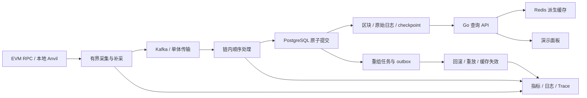

# ChainPulse：Web3 + Go 后端转型交付计划

## Title

ChainPulse 求职项目的系统性优化、验收与 CI/CD 交付方案（v9）

## Type

architecture

## Status

Status: Approved

方案已经作者确认范围与决策；后续按 §12 交办协议执行 T00–T18，实施未完成前不得标为 Implemented。

## Owner

项目作者。下表中的“负责人”默认均为作者；AI 可在明确交办的任务范围内协助实现与验证。

## Reviewers

项目作者（范围与设计决策）；代码评审者（可由同伴或后续独立评审承担，不能虚构已完成评审）。

## Date

2026-10-12，Asia/Singapore。

## Related Modules

当前生产链路涉及 `cmd/`、`pkg/core`、`pkg/ports`、`pkg/blockchain`、`pkg/application/indexing`、`pkg/services/{indexing,processor,reorg,finality,query}`、`pkg/plugins/{pullers,database,mq,cache,api}`、`pkg/infrastructure/database`、`pkg/evm`、`pkg/siwe`；交付涉及 `migrations/`、`docker/`、`monitoring/`、`frontend/`、`test/`、`contracts/`、`scripts/`、`.github/workflows/`。

这只是本轮关注范围，不替代文件系统中的实时目录和模块清单。

## 1. 背景、目标与交付边界

你的目标是转型 **Web3 + Go 后端**，全职投入 **4–6 周**。10+ 年 C++、6+ 年音视频流媒体前后端及 iOS/Android native player 经验，是并发、实时数据、性能分析、协议处理和故障恢复的基础。项目应补足可验证的 Go 工程能力与链上数据语义，而不是继续以语言数量、代码行数或组件数量为亮点。

本轮交付目标：**一个能从真实 EVM 日志采集、可靠持久化，到 API 查询、重组恢复、故障演练和版本发布的 Go 后端系统**。招聘方能在 5 分钟内看到正常链路，在 15 分钟内复现一次失败与恢复；作者能用代码、测试和测量数据解释核心决策。

| 已有经验 | 本项目中的迁移能力 | 必须提交的证据 |
| --- | --- | --- |
| 流媒体缓冲与弱网恢复 | 有界队列、RPC 限流、断连补采、积压追赶 | T10 压力与故障测试、T14 恢复曲线 |
| C++ 多线程与资源生命周期 | Go goroutine 所有权、context 取消、race 与泄漏检查 | T10 并发测试、CPU/heap/goroutine profile |
| 编解码和协议解析 | ABI/topics/data、签名整数、金额精度、升级兼容 | T09 固定语料与 fuzz 回归 |
| 播放时序与状态机 | 链内排序、分叉切换、checkpoint 与 finality | T05–T07 不变量与重放摘要 |
| 前后端端到端调试 | OpenAPI、查询与订阅、追踪、可运行展示 | T11–T13 API/浏览器验收 |

### Scope

必做范围冻结为 T00–T18。以 **PostgreSQL + Kafka + Redis + EVM** 为主要生产验收组合；单体保留零依赖学习路径，并与四服务模式复用关键业务契约。

链支持承诺：两个独立本地 EVM 链用于隔离与故障测试；Ethereum/Sepolia 的标准 RPC 语义为基准。外部测试网小范围烟测用于证明真实接入，不能取代确定性 CI。现有 Solana/Cosmos 等能力保留，但只有通过各自完整验收的配置才能列入支持矩阵的“已验证”栏。

### Non-Goals

本轮不扩张新链、数据库或 MQ 实现；不做全仓库 DDD 重写、重构七模块为单模块、完整 K8s 运维平台、自建 RPC 节点、MEV/套利系统、跨链桥、ERC-4337、交易托管签名或钱包客户端。StreamGate 的写交易/NFT/播放器联动列为后续产品方向，不是本轮完成条件。

索引器的读路径本身能证明 Web3 后端能力；“缺少交易发送”不是必须填补的架构缺陷。测试合约和测试账户只用于制造事件，不变成业务签名服务。

“一次规划到位”定义为：本轮任务、依赖、测试矩阵、证据格式、范围切换条件与最终门禁一次确定。不能保证软件从此没有新漏洞、链协议变更或依赖升级；范围内的问题归入原任务修复，范围外的需求只有触发 §12 条件才重开。

## 2. 本轮评审结论与证据等级

详细命令和原始输出见 [本轮基线报告](../project/2026-10-12-web3-go-baseline.md)。这是当前工作区的静态评审与本地质量基线，不是生产安全审计，也没有声称全部适配器已动态验收。

| ID | 本轮观察 | 优先级 / 对应任务 |
| --- | --- | --- |
| F01 | `test.yml` 捕获测试退出码后主要按文本判断失败，部分分支最终 `exit 0`；Foundry/Anvil 存在宽松失败处理 | P0 / T01 |
| F02 | `test/contracts` 只有 `DatabaseContractTest`、`CacheContractTest` 辅助函数；`go test -tags=integration ... -list .` 未列出任何测试 | P0 / T02 |
| F03 | PostgreSQL 的重组更新、范围删除、块查询、最新块查询缺少链过滤；共享库部署有串链风险 | P0 / T03 |
| F04 | 生产插入使用 `event_hash`；初始迁移定义 `id` 与必填 `block_hash`；自然键迁移指向 `events_metadata`。存在 schema 与运行路径分裂 | P0 / T02、T04 |
| F05 | `CheckAndMark` 新增后只有测试调用；生产 processor 仍先查重再写再标记；shared runtime 的事件、去重、checkpoint 为分步提交 | P0 / T05 |
| F06 | 事件自然键包含块高而不含块哈希，不能单独表达同高替换分支和同一交易重新入块的历史身份 | P0 / T04、T06 |
| F07 | 重组回滚后的通知发布失败仅记录日志；没有在已读路径中看到持久化重组任务与投递的原子保证 | P0 / T06；先用故障注入确认调用路径 |
| F08 | finality checker 用 L2 `safe` 近似 finalized、失败时退到 latest；bool 接口仍按高度返回真，降级字段不足以保证调用者不会误用 | P0 / T07 |
| F09 | SIWE origin 检查已接入 handler；nonce 校验忽略已存地址，Get/Delete 分离；清理 goroutine 没有停止接口 | P0 / T08 |
| F10 | `metrics.yml` 回归检查存在 TODO，部分采集失败被忽略；`deploy.yml` 多项验证/构建/部署允许继续 | P0 / T01、T14、T15 |
| F11 | 旧计划记录摄取性能未验收；当前脚本可忽略发压失败或跳过摄取。旧查询数字不能证明整条链路吞吐 | P1 / T14 |
| F12 | 旧架构文档禁止 spec，技能引用已不存在的 `pkg/adapters`；AGENTS 的 skip 数字与当前工作区不一致 | P0 / T00：统一规则来源，不按过时示例实施 |

v8 追加评审（2026-10-12 第二轮，针对“验收和 CI/CD 通过”的盲区，命令与原始证据见各条）：

| ID | 本轮观察 | 优先级 / 对应任务 |
| --- | --- | --- |
| F13 | 第 7 个 workflow `ci-integration.yml`（"Integration & E2E Tests"）完全不在本方案范围：其 `contract` job 在 PR 上跑 `test/contracts` 空 suite 必然假绿（exit 0 无 Test）；`e2e` job 仅 schedule/dispatch 触发，PR 不跑；`integration` job 有真实 147 Test 但不在目标 lane 表中 | P0 / T01：并入目标 lane 或显式退役，禁止留一个 PR 上的假绿 check |
| F14 | GitHub 侧无门禁载体：`gh api repos/rtcdance/chainpulse/branches/main/protection` → 404，`rulesets` → 空。§7.3 的 required checks 没有任何机制强制执行，勾与不勾无区别 | P0 / T01：配置 branch protection/ruleset 并以 API 反证验收 |
| F15 | `contracts/`（Foundry）资产当前不可编译：`forge test` 报 `lib/forge-std/src/Test.sol not found`（contracts/lib 缺失）。E01/E11 与 `evm-e2e` lane 的真实合约 fixture 无前置 | P1 / T02：vendoring forge-std（或 go.mod 外固定版本安装步骤）+ `forge build/test` 进门禁 |
| F16 | E01 要求"一个已校验的 Swap fixture"，但仓库内未找到 Uniswap V3 Swap topic0（`0xc42079f9…`）的现成 fixture；T09 的解码验收缺数据来源 | P1 / T09：落实 fixture 来源（本地 fork/固定已校验 tx 的 raw log），并入固定语料 |
| F17 | AGENTS 规定依赖变更必须同步 `docs/project/DEPENDENCY_APPROVAL.md`，但该义务未出现在任何任务、§7 或 §10 DoD 中 | P1 / T01、T15、§10：写入门禁清单，缺更新即 DoD 不通过 |
| F18 | 关键正确性修复（A-4a~f：SIWE `VerifySIWEWithOrigin`、signed int 解码、`CheckAndMark` 幂等等）只存在于 dirty 工作区，`git show HEAD:pkg/siwe/siwe.go` 不含它们；而 T18 要求"从最终 SHA 新检出"验收——不先分批落 commit，最终 SHA 会静默丢失这些修复。当前 dirty 94 项与 3 个 stash 需要落地/清理策略 | P0 / T00：先制定分批 land 计划（区分本项目修复与他人改动），修复必须进入最终 SHA 才允许 T18 |
| F19 | skip/测试规模口径三处不一致：AGENTS "~89 t.Skip"、基线 "69 skip actions"、实测 `t.Skip(` 72 处/29 文件；另有 integration 147 Test、e2e 349 Test 未纳入 §7.2 manifest 的规模估算 | P1 / T00、T02：T00 以命令实测重建分类表，manifest 映射按此规模排期 |
| F20 | README 结构树缺 `contracts/` 等真实目录，badge 只指向 ci/test 两个 workflow；与目标 lane 表和最终交付形态不一致 | P2 / T17 |

v9 追加评审（2026-10-12 第三轮，以 Web3 首席架构师 + 求职目标视角审"只做这一次 plan"的剩余盲区；本轮已重新抽查仓库事实：7 个 workflow、`contracts/lib` 缺失、`test/contracts` 无 runner、`VerifySIWEWithOrigin` 仅在工作区、`test.yml` 仍文本 grep + `exit 0` 均属实）：

| ID | 本轮观察 | 优先级 / 对应任务 |
| --- | --- | --- |
| F21 | 验收工具链没有任务归属：§8 与 E01–E15 反复依赖 "canonical oracle 摘要"、§7.2 依赖 tests.jsonl "检验器"、§10 依赖 manifest 证据收集器，但没有任何任务实现它们；T18 手工拼装 15+ 工件必然滑期或产出不可核验证据 | P0 / T02、T12、T18：oracle→T02、检验器→T01、证据收集器→T12，T18 只消费 |
| F22 | CD 部署目标未冻结：§7.5 只写"一台已有可用 Linux/Docker 环境"，未指名环境与可得性；W4 才发现环境不可用会直接阻塞封版 | P0 / T00：冻结部署目标（本地 Docker 演示 / 云 VM / 已有服务器）并前置连通性验证 |
| F23 | CI 资源与时长预算缺失：目标 lane 含双 Anvil+Kafka+Postgres+Redis、147 integration + 349 e2e、30min soak"热路径 PR 也触发"；GitHub 托管 runner（2–4 vCPU）极易超时并烧尽免费额度 | P1 / T01、§7.3：lane 时长预算、PR/nightly 分层、Go/npm cache、concurrency |
| F24 | 优雅停机语义未验收：kill 覆盖崩溃，但 Docker stop/部署滚动走 SIGTERM；in-flight 批次收尾与 checkpoint 连续性没有测试，CD 每次部署都会踩 | P1 / T05、E05 |
| F25 | Provider 能力差异未入 T10：eth_getLogs 区块范围/结果条数上限、geth/erigon/reth 响应差异会直接影响真实接入；现只覆盖 429/5xx/断连 | P1 / T10 |
| F26 | 面试深挖储备不足：首席架构师岗位必然追问"10 倍/50 链怎么扩展"、"桥攻击/MEV/账户抽象的安全边界"；本项目可不实现，但没有准备设计论证材料，深挖时无落点 | P2 / T17：10x 扩展设计文档（只设计不实现）+ 安全案例讨论提纲 |
| F27 | baseline 数字已漂移：F18 记 dirty 94/3 stash，本轮实测 95/4（含 stash@{3} "wip: local tooling"）；F19 三口径问题依旧。T00 必须以当日命令实测为准，不能沿用本文数字 | P2 / T00 |
| F28 | Kafka 分区与链内顺序的契约未写死：§4.2 隐含"按 partition 持久化消费进度"，但未规定分区键=chain key；链内有序与跨链并行的正确性依赖这一选择 | P2 / T05、§4.2 |

当前已具备的代码不重新作为“从零开发”：四服务入口、单体/Playground、API/UI、重组与 finality 框架、ERC20/Uniswap 解码、DLQ、指标和现有回归测试。任务的重点是核验 wiring、补齐语义与故障路径，再交付可复现结果。

旧 v6 的完成标记只保留历史意义。当前无 `pre-existing` 文本 skip，不代表没有 skip：本轮短测试 JSON 有 **69 个 skip 测试动作**；必须逐项分类，不能删测试获取绿色结果。三个口径互不一致（AGENTS "~89"、JSON 69、源码 `t.Skip(` 72 处/29 文件，见 F19），T00 必须以命令实测重建唯一口径，本方案其他章节在 T00 完成前引用的数字均为待核对初值。当前 root 范围 build/check/lint/short 通过，也不能代表其余 workspace modules 或真实基础设施通过。

## 3. Options Considered 与 Selected Approach

| 方案 | 收益 | 代价与判断 |
| --- | --- | --- |
| 继续扩链、扩协议与基础设施 | 功能清单更长 | 验收组合膨胀；4–6 周难以形成可信证据，暂缓 |
| 全仓库 Clean Architecture 重写 | 长期边界更规整 | 现有迁移状态复杂，会吞掉业务正确性预算，暂缓 |
| 聚焦一条生产链路，修正确性与验收，再做展示 | Go/Web3/数据库/MQ/API 能力能被同时检验 | 本轮采用；仅在触及的接口与组合根整理依赖 |

关键决策：

1. PostgreSQL 是事件、区块、checkpoint 和重组任务的事实来源；Redis 是可丢失的派生缓存，Kafka 是可重投的传输。
2. 对外承诺 at-least-once 交付 + 幂等持久化效果。Kafka 到 PostgreSQL 的边界不能凭 Kafka 事务宣称端到端 exactly-once；输出与消费进度必须协调。[Kafka 官方设计](https://kafka.apache.org/40/design/design/)
3. 每条链先采用一个有所有权的顺序提交者。RPC 获取与纯解码允许有界并行，提交按链内连续序列推进；不因微服务部署就引入多主写入。
4. 区分物理事件身份、canonical 分支、finality 与处理状态；不能用一个 `status` 字段同时承担全部语义。
5. 单体与四服务复用关键处理契约，验证输出等价；只测试本轮公开承诺的能力，不承诺所有历史插件完全等价。



## 4. Data / Contract Impact：实施前冻结的不变量

| 编号 | 必须成立的规则 | 验证方式 |
| --- | --- | --- |
| I01 | 所有事件、区块、checkpoint、缓存与重组操作必须明确 chain key | 双链同高度/同交易样例；重组 A 后 B 的摘要不变 |
| I02 | physical event ID = `(canonical chain key, block_hash, tx_hash, log_index)`；块高用于排序和范围，不能替代块身份 | 同高异哈希、交易重新入块、重复消息测试 |
| I03 | 每链每高度最多一个 canonical 块；孤块事件可审计但不出现在默认查询中 | 分叉切换、canonical 唯一约束、显式历史查询 |
| I04 | 持久化 checkpoint 只到最后一个已完成的连续块，包括零日志块 | 空块、部分批次失败、乱序到达、崩溃恢复 |
| I05 | 原始事件、业务投影和 checkpoint 的权威更新同事务；缓存故障不能取消已经成功的提交 | commit 前后 kill，Redis 停止与重投 |
| I06 | Kafka partition offset 只能在相应持久化效果成功后推进；不能越过尚未完成的消息 | 重投、rebalance、并行处理低 offset 失败 |
| I07 | 重组撤销与修复任务持久化后才报告已安排恢复；进程重启可继续，重放幂等 | DB 成功但发布失败、修复中再次崩溃 |
| I08 | `latest`、`safe`、`finalized`、确认数估计和未知状态具有不同含义 | RPC 标签缺失/错误/过期、L2 样例 |
| I09 | nonce 绑定地址、origin、chain 和会话意图；同一 challenge 并发最多成功一次 | 两实例并发验签、地址互换、过期/重放 |
| I10 | 失败、空跑、缺少工件、必需测试跳过都不能形成发布成功 | CI 阳性失败注入与部署故障演练 |

### 4.1 事件模型与数据库

T02 先用全新数据库和现有升级路径核对实际写读表，再决定字段落点，禁止为迎合旧文档创建第二套表。原始事件保存 topics/data、区块哈希、交易哈希、tx index、log index、链时间与来源；解码记录增加 decoder/schema 版本，保留重新解码入口。

链 key 由统一 resolver 产生。EVM 使用数值 chain ID 的一致表示；人类别名映射到同一 key；不同链身份不能因同名配置或同高而合并。

金额与大整数采用 Go `big.Int`、数据库可无损表达的数值/字符串和 JSON 字符串；禁止 float64 作为资产值。字段的单位、decimals 与原始值都可追溯，展示换算单独处理。

迁移采用 expand → backfill → verify → switch → 后续 contract。本轮保留旧字段和兼容读取，不在同次发布删除旧列。迁移编号由实时文件系统决定；记录行数、空值、重复键、canonical 摘要及中断续跑结果。

### 4.2 原子提交、幂等与恢复

本轮选择 PostgreSQL 事务包住块头、事件、必要投影与处理 checkpoint；按 partition 持久化消费进度，Kafka commit 在 DB commit 之后。发生 DB 成功/Kafka commit 失败时允许重投，靠 DB 唯一约束消除重复效果。

采集游标与处理 checkpoint 分开命名。采集游标只说明已交付给传输，不能作为查询完整性的证明。若先推进采集游标，必须保证数据已可靠入队且保留从处理 checkpoint 补采的恢复入口。

不得直接把处理入口全部改成 `CheckAndMark` 后再写库：预先标成 processed 会在写失败后丢失重试。内存去重只优化已提交事件，不能替代 durable commit。事务接口应放到现有真实契约边界，通过具体 DB driver/小接口消除 `any` 的错误方法签名断言。

首次版本用单链写入者 + 明确部署副本限制。Kafka consumer group 负责分区所有权，DB generation/owner token 在事务内防止 rebalance 后旧 worker 继续提交；单体通过同类 chain lease 或启动互斥避免重复写入。lease 失效、关闭或 reorg 世代变更均停止旧提交。Kafka 分区键固定为 chain key：链内消息有序、跨链并行消费；分区数量与每链并发提交者上限在 T05 契约中冻结并写入测试（F28）。

checkpoint 是完成范围的游标，不是 `max(event.block_number)`。整批重复、零日志块也要完成相应 checkpoint；排序缺口存在时暂停推进。reorg 后按新 generation 将 checkpoint 回退到共同祖先，普通旧 worker 不得覆盖它。

### 4.3 重组与 finality

重组流程固定为：检测 parent/hash 不一致 → 限制扫描找到共同祖先 → 持久化 repair job → 同事务撤销 canonical 标记、回退 checkpoint、增加 generation、登记缓存失效/outbox → 有界重采 → 重建派生结果 → 核对摘要 → 完成任务。

大于配置最大深度的重组、已 finalized 范围变化或找不到祖先，进入停止提交与告警状态，不能静默扫全链或继续返回健康。块 0、future checkpoint、RPC 错误和 uint64 下溢均有测试。

Ethereum 以 RPC 返回的 `safe`/`finalized` 块哈希与高度为据，不把固定 32/64 个块写成共识保证。标签不支持时保留 `unknown/degraded`；可配置的 confirmation-depth 只叫估计。标准标签见 [Ethereum JSON-RPC](https://ethereum.org/developers/docs/apis/json-rpc/)。

L2 safe 与 finalized 不能互换，也不能用固定块数折扣推算最终性。OP Stack 的 finalized L2 来源于 finalized L1 数据，而提款挑战期是不同概念。已有 L2 代码本轮至少修正误标和能力声明；完整 L2 验收超出基准链范围时标为 experimental。[OP Stack 规范](https://specs.optimism.io/protocol/derivation.html)

### 4.4 API 与权限

保留现有 `/api/v1` 消费者行为，新增内容使用可选字段、显式参数或经过评审的版本。canonical 默认过滤属于语义变化，必须给出旧消费者兼容方案与 OpenAPI/contract 差异测试，不能只因 JSON 结构未变就称向后兼容。

查询以链 + 稳定 cursor 为核心；cursor 包含排序位置、过滤条件摘要、canonical generation。重组导致旧 cursor 不再成立时返回可识别错误与重新查询提示，避免静默漏项。现有 offset API 保留并加上限。

公共只读、认证用户、管理员分三类权限；replay、runtime control、DLQ、pprof 不公开匿名访问。WebSocket/SSE 设置连接数、订阅范围、缓冲上限、断开策略与重连游标，订阅更正/撤销必须可识别。

## 5. 可执行任务清单

状态统一为 Planned → In Progress → Verified；只有验收命令、退出码、测试动作/skip、摘要和工件都齐全才能 Verified。以下全部为 **Planned**，T00 引用本轮已取得的观察，仍需在最终交付分支重新建立基线。

估时是对已有实现可复用的工程判断，单位为专注小时；不是保证。T00–T18 合计 **175h**（v8 因 F13–F16 扩展至 162h；v9 因 F21–F25 再扩展：T00 4→5h、T01 14→16h、T02 12→14h、T05 16→18h、T10 10→12h、T12 8→10h、T17 6→8h），加 **24h** 修复与环境缓冲，总预算 **199h**。T02 第一周暴露的 schema/wiring 工作若超预算，按 §6 转六周交付，不能降低正确性门槛。

| ID / 优先级 / 小时 | 依赖 | 执行顺序与文件落点 | 验收与失败判据 |
| --- | --- | --- | --- |
| T00 / P0 / 5h：范围与规则 | 无 | 保存 dirty baseline、HEAD 与模块清单；核对 AGENTS 与旧规则冲突；旧规则页改为指向 AGENTS；将旧 v6 完成标记映射到本计划；**制定 dirty 落地计划（F18）：将 A-4a~f 等本项目修复按主题分批 commit，与他人改动严格分离，全部 stash（实测 4 个，F27）逐个 `stash show` 分类后保留/落地/丢弃（丢弃需人工确认）**；以命令实测重建 skip 分类表与 integration(147)/e2e(349) Test 清单（F19，数字以当日命令为准）；**冻结部署目标与外部资源决策（F22）：CD 目标环境（本地 Docker 演示 / 云 VM / 已有服务器）+ 外部测试网 RPC 来源与配额**；**设计验收工具链清单（F21）：canonical digest oracle、tests.jsonl 检验器、empty-run 检测、证据收集器的落点（`test/acceptance/tools` 或 `scripts/acceptance`）与接口**；设计写为 Draft，人工确认后 Approved | 一份支持矩阵、一份 skip 分类表（唯一口径）、一份任务到证据映射、一份 dirty→commit 批次计划；旧示例不再要求创建 `pkg/adapters`；非本任务 dirty 文件不被重置；**`git show HEAD:` 抽查确认关键修复已在提交历史中**；**部署目标连通性验证记录 + 验收工具链清单与落点确认（F21/F22）** |
| T01 / P0 / 16h：真实 CI 门禁 | T00 | 修改 `test.yml`/`coverage.yml`/`ci.yml` 的退出码传播；**处置第 7 个 workflow `ci-integration.yml`（F13）：将其 integration/contract/e2e 三个 job 按目标 lane 归并（contract 空 suite 修复前禁止以 green 呈现，e2e 明确触发条件），或整体退役并以新 lane 取代——二选一，不能留下 PR 上跑空 suite 的假绿 check**；**配置 GitHub branch protection/ruleset（F14）：将 §7.3 acceptance-gate 设为 main 必需 check、禁止绕过直推，配置后用 `gh api` 反证 ruleset 存在且 PR 缺失 check 时合并被拒**；统一 build→check→lint→test；固定工具；**实现 tests.jsonl 检验器与 empty-run 检测（F21，CI 直接消费）**；JSON 统计 pass/fail/skip；依赖未起、超时、缺失 profile 立即失败；清理 micro-loop 的编译顺序与 lint 口径；**实施 lane 资源预算（F23）：Go module 与 npm cache、concurrency cancel-in-progress、PR 与 nightly 分层（chaos-soak-perf 仅 nightly/RC/tag/热路径 PR）、lane 名称在 T15 固定后不再改名（ruleset 依赖名称）** | 阳性对照触发编译错误、断言失败、timeout、无测试、必需 skip、缺失 coverage 六类失败，各自使 required check 失败且不发布；**`gh api .../rulesets` 返回非空、删除 required check 的测试 PR 被 GitHub 拒绝合并；`ci-integration.yml` 处置有 commit 证据（归并或删除）**；**各 lane 实测时长在 §7.3 预算内，cache 未命中仍在预算内完成**；范围超 16h 时按 §6 用缓冲并记录 |
| T02 / P0 / 14h：真实适配器与 schema | T01 | 在 `test/contracts` 新增 `Test...` runner，调用同一套内存/Postgres、内存/Redis契约；Kafka 验证 publish、consume、ack、redelivery；从空 DB 运行迁移并经真实服务写读；核对 manager/checkpoint 具体 driver；**实现 canonical digest oracle（F21）：按 I02/I03 元组 stable sort 聚合摘要，供 T03 起所有摘要验收与 E01–E13 复用，oracle 自身有测试**；**恢复 Foundry 资产可编译（F15）：vendoring/安装 forge-std 到 `contracts/lib`（版本固定并记录），`forge build` + `forge test` 通过，Anvil 发射 EventEmitter 事件作为 evm-e2e 前置** | suite 列出实际 Test 名；各生产 factory 都有 executed case；空库与升级库可写读；任何 DB 方法签名错误、缺列/表/约束失败不能被 mock 遮蔽；**oracle 对固定输入摘要稳定、乱序输入摘要一致**；**`forge test` exit 0 且列出 Test 名；缺 forge-std 时 `evm-e2e` lane 必须失败而非跳过（对应 §7.4 注入行）** |
| T03 / P0 / 6h：链隔离 | T02 | 为块/事件/重组/去重失效接口增加链作用域并逐层传入；修 Postgres、缓存和 metadata 查询；旧未限定链方法仅允许明确单链上下文 | A/B 两链同高数据；A rollback 后 B rows、hash、checkpoint、cache 摘要逐字一致；不明确链的生产操作被拒绝 |
| T04 / P0 / 10h：事件身份与迁移 | T02、T03 | 修改 `pkg/blockchain`、event hash 与相关 DB 映射；保留原始日志，分离 physical/canonical/processing/finality；补正确唯一索引和版本字段；保留旧 ID 映射 | 相同消息重复 100 次仍单份效果；同高替换分支可审计；重新入块的新 physical ID 存在；迁移前后摘要和兼容 API 合格 |
| T05 / P0 / 18h：提交与 checkpoint | T04 | 在现有 ports/core 契约处设计事务提交能力，接通 shared runtime 和 processor；事件/投影/checkpoint 原子提交；消费进度与 ack 对齐；空块、全重复批次、世代与 owner fencing；**冻结 Kafka 分区键=chain key 的消费契约（F28）；实现 SIGTERM 优雅停机收尾（F24）：in-flight 批次完成、checkpoint 连续、无半提交** | commit 前后及 ack 前后四处 kill/restart，各 10 次；无漏项、重复效果 0；checkpoint 无缺口；rebalance 后旧 worker 提交被拒绝；从 durable checkpoint 重建；**SIGTERM 优雅停机 10 次后 checkpoint 连续、无半提交、退出码 0；分区键契约有对应测试** |
| T06 / P0 / 12h：重组闭环 | T05 | 改 `pkg/services/reorg` 与调用方；persistent repair job + transactional outbox；撤销 canonical/派生结果、回退 checkpoint、generation 失效缓存；从未完成 job 续跑 | 深度 1/2/12，重放重复，修复中崩溃，outbox 失败后重启；结果与新 canonical oracle 摘要一致；超深度/祖先未知停止提交 |
| T07 / P0 / 6h：finality | T04 | 修改 finality checker、strategy 与所有调用方；显式 confidence/source/observed_at；bool 兼容接口遇 degraded 不返回 finalized=true；支持标签探测与过期策略 | latest fallback、标签错误、safe≠finalized、provider 分歧、缓存过期；无一事件错误晋升 finalized；前后端均呈现 unknown/degraded |
| T08 / P0 / 8h：SIWE 与访问边界 | T01 | 在 siwe/API 修严格格式、origin/URI/chain/version/time 校验，签名验证原始规范消息；Redis 原子 compare-and-consume 绑定 nonce 与地址；清理循环受 context 管理；operator 路由 RBAC、限流、错误脱敏 | 同 nonce 两实例 100 并发只成功一次；错误地址/域名/链/URI、过期、非法格式拒绝；匿名 replay/pprof/control 禁止；拒绝参数与重启无泄漏 |
| T09 / P1 / 6h：解码与精度 | T04 | 保留当前 signed int 修复，补 ERC20 与一个 Uniswap V3 Swap 的实际 fixture；**落实 fixture 来源（F16）：优先从本地 Anvil/fork 部署的已校验合约生成 raw log，或固定公开主网 tx 的 raw receipt 子集并附来源 tx hash 与校验记录，随固定语料提交**；未知 topic/ABI 变更进明确 raw-only/DLQ 策略；fuzz 语料固定回归 | int24/int256 边界、负值、uint256 最大值、错误长度、decimals；无 panic/float 损失；fixed raw→typed 结果与预期逐字段相同；**Swap fixture 有可追溯来源与预期解码结果，缺 fixture 时 E01/E11 判失败** |
| T10 / P1 / 12h：RPC 与 Go 并发 | T05 | 盘点拉取/消费/缓存/订阅 goroutine；有界 worker、queue、batch、timeout/retry budget；按429/5xx/无效请求分类，jitter 与 Retry-After；WS 断开后 HTTP 按连续范围补采；provider chain/genesis 校验；**provider 能力适配（F25）：eth_getLogs 区块范围/结果条数上限探测与范围切分/二分退避，兼容 geth/erigon/reth 响应差异** | race 无告警；429/超时/断连/错误链不丢数据；取消后 worker 可收敛；队列不超配置；失败范围不跳过；provider 切换不串链；**受限 provider（低 range 上限/低结果上限）下不丢块、不失控重试** |
| T11 / P1 / 8h：Go API 与查询 | T03–T07 | 完善稳定 cursor、chain/filter/范围上限、金额字符串、错误码和订阅恢复；依据真实查询 EXPLAIN 添加最小索引；版本化缓存键 | 双链、重组、并发分页、冷/热缓存/Redis 故障契约；OpenAPI 差异通过；缓存失效后不返回旧 canonical 结果；非法/过大查询拒绝 |
| T12 / P1 / 10h：wiring 与用户演示 | T05–T11 | 复用已有 local/compose 验证脚本；两个 Anvil 链、测试合约、Postgres/Kafka/Redis、单体/四服务配置；修实际启动错误；Playwright 只覆盖主流程；**实现证据收集器（F21）：统一归档 §10 证据包（manifest.json、tests.jsonl、skip-report、摘要、profile、run URL），供 T18 直接消费，收集器有自测** | 新 checkout 一条启动入口可执行；真实 emit→query→reorg→recovery；两种模式 oracle 摘要一致；UI 无伪造成功或回退假数据；**收集器一次运行产出完整 §10 清单，缺工件即失败** |
| T13 / P1 / 6h：SLO 与诊断 | T05–T12 | 扩展已有 metrics/monitoring；区分采集/提交/finalized lag；trace 连续跨 MQ；readiness 看依赖和处理可用性，liveness 看进程；每个告警对应 runbook | 注入 RPC、DB、MQ 故障时指标变化与告警按预期出现，恢复后消退；标签无 tx hash/address/block height 无界基数；依赖故障 readiness 失败 |
| T14 / P1 / 10h：性能与成本 | T10–T13 | 修 `scripts/bench` 发压/超时失败，区分发送、入队、提交、查询；固定 corpus、chain profile 与环境；运行 §8 负载、profile、容量估算；数值解析实际接入 metrics regression | 零缺失/重复是前置；输出完整有效原始数据与摘要；发送端受限不能称索引吞吐；性能劣化/缺指标阳性对照使门禁失败 |
| T15 / P1 / 8h：版本与 CD | T01、T12 | 复用 release/deploy workflows；同 SHA 全门禁→不可变镜像 digest→暂存环境→真实 smoke→提升；单体与四服务目标；修 checksum 覆盖；固定 action SHA、tool/image 版本；SBOM 与漏洞扫描；**任何依赖/工具版本变更同步更新 `docs/project/DEPENDENCY_APPROVAL.md`（F17，AGENTS 强制）** | 每个发布文件有正确 checksum；缺服务镜像/secret/工件即失败；部署失败不报告成功；同 digest 提升；无可调用漏洞未处置；无匿名 operator 暴露；**依赖变更而 DEPENDENCY_APPROVAL.md 未更新时 §10 DoD 不通过** |
| T16 / P1 / 6h：故障与回滚演练 | T06、T13–T15 | 用当前 chaos/rollback/rehearsal 脚本扩展 DB/MQ/RPC/Redis、kill、重组、版本回滚与数据恢复；不重复创建演练框架 | §9 故障矩阵全部有运行证据；旧版本恢复查询，checkpoint/摘要一致；RPO/RTO按本地受控范围报告，不冒充跨机房保证 |
| T17 / P1 / 8h：求职证据 | T12–T16 | 更新 README 首屏与能力矩阵；**结构树补齐 `contracts/` 等真实目录、badge 与 §7.3 最终 lane 对齐（F20）**；一张实际架构图、三份核心 ADR、3–5 分钟录屏、性能报告、故障报告、英文项目摘要；整理作者能讲解的 Go/Web3 代码；**补两份轻量叙事文档（F26）：10x/50 链扩展设计（只设计不实现）、Web3 安全案例讨论提纲（桥攻击/MEV/账户抽象的防线取舍），作为面试深挖储备** | 新机器 5 分钟 happy path；15 分钟复现故障；录屏对应已验收 tag；简历全部指标可定位工件；20 个问题有代码/测试答案；**README 无过时路径/失效 badge；10x 设计与本项目 ADR 相互引用，不暗示未实现能力** |
| T18 / P0 / 6h：封版验收 | T00–T17 | 从最终 SHA 新检出运行全部必需检查；**先确认 T00 的 dirty 落地计划已执行完毕：`git status` 仅剩已声明的非交付改动，关键修复可用 `git show <final-sha>:<file>` 抽查证实（F18）**；**用 T12 证据收集器生成 final evidence manifest，不手工拼装（F21）**；核对支持矩阵、残余风险、远端 run URL、release digest、回滚演练；封版后只修阻塞 bug | §10 checklist 全部通过；零 P0 未解决、零必需 case 跳过、零测试空跑；原始输出和 SHA 一致；**ruleset/required checks 与最终 SHA 的远端 CI run 可复核**；作者签字确认 scope 达成后改 Implemented |

## 6. 4–6 周执行节奏、依赖和超时处理

| 周 | 工作与预算 | 周末必须交出的证据 |
| --- | --- | --- |
| W1 | T00–T04，51h；先 CI 再真实 DB 与链隔离 | 失败会红的 CI、**GitHub ruleset 生效证据、forge test 通过**、真正运行的契约、fresh/upgrade schema、physical ID 与隔离回归 |
| W2 | T05–T09，50h；互不依赖任务交错执行 | durable commit、重组恢复、正确 finality、一次性 SIWE、解码证据（含来源可追溯的 Swap fixture） |
| W3 | T10–T14，46h | 有界恢复、API 契约、单体/四服务真实 E2E、SLO、有效性能报告 |
| W4 | T15–T18，28h + 最多 24h 缓冲 | 可验证 CD、故障/回滚、求职证据包、最终 release candidate |
| W5–W6（触发时） | 将上述 199h 分配为每周约 30h 专注工作；用于已识别阻塞修复与环境恢复 | 原验收标准不变；不追加新功能 |

四周是高强度窗口；六周是推荐排期，允许调试、理解、评审和环境开销。日历参考：2026-10-12 开始，四周至 2026-11-08，六周至 2026-11-22；实际从设计确认和开始实施之日顺延。

关键路径：T01 → T02 → T03/T04 → T05 → T06/T07 → T10/T11 → T12 → T14/T15 → T16 → T18。T08 可在 T01 后穿插；T13 指标从正确性实现开始同步补，不等第三周才临时加。

以下触发排期调整，不再反复开新优化评审：

- T02 用 10h 仍无法跑通 fresh DB/生产 wiring：用缓冲并切六周；停止 UI 修饰和全部可选扩展。
- T05/T06 发现两套处理路径难以统一：先以同一提交契约打通已承诺链路；历史路径标清边界，不能只修测试用实现。
- 公网 RPC/镜像拉取不稳定：本地确定性链继续验证；修网络与版本来源。外部 smoke 标 Pending，不能宣称上线通过。
- T00 冻结的部署目标（F22）在 W3 末仍不可用：切到备用目标（优先本地 Docker 演示）并在证据中明确标注部署形态；CD 结论不得夸大为多环境部署。
- 到 W4 P0 仍未关闭：暂停封版，消耗 W5/W6 修正确性；不能以删测试、降 CI 门槛或伪造摘要结项。
- 预算用尽仍有必需项失败：交付为未完成并写出具体阻塞、已执行记录及所需时间，不能把范围悄悄缩小后称全量达成。

## 7. 测试、CI/CD 与通过标准

### 7.1 本地门禁与 workspace 完整性

每个任务先写对应反例、观察失败，再实现最小改变、跑相关测试和 race（涉及并发时），最后运行仓库质量门禁。改动只在其负责文件格式化，不运行会顺带 tidy 全仓库的 `make fmt`。

以下现有命令必须按顺序运行并保存完整输出及 exit code：

```bash
export GOPROXY=https://goproxy.cn,direct
go build ./...
make check
make lint
make test-short
git diff --stat
```

PR template 还要求 `make build`、`make test-unit`、`make vet`；它们与上述门禁保持一致，不能只勾选未跑命令。`make lint` 的 diff scope 用于日常门禁，最终封版另跑 `--tests=false` 全量命令；测试 helper 的 unused 问题按实际 scope 分类，不能随意切 scope 取得“0 issues”。

根目录 `./...` 不等于整个 Go workspace。T01 从 `go work edit -json` 动态枚举每个 `.Use[].DiskPath`，对每个 module 执行 build/vet/test；根模块另外执行 cmd 测试。CI 检查 go.work 的 go 指令不低于任一模块，版本/config 变更单独提交，不添加 toolchain 指令。

全量 lint 要覆盖实际 workspace 模块（先动态枚举再在模块执行），同时留存 root 标准口径结果；不能靠根命令未进入子模块来完成。

### 7.2 测试执行与 skip 规则

Go 测试输出同时保存 JSONL 和原始 log。检验器分别统计有 `Test` 字段的 pass/fail/skip、顶层 Test 名、package 成败和无测试包；父子 subtest 的 pass 动作不能当作独立测试数量，不能把 “6674 pass actions” 写成 6674 条顶层测试。

T00 为本轮 69 skip 分类：短模式主动排除长测、依赖缺失、历史残余、未实现/不稳定。每项记录 package/Test/reason/owner/去往哪个 full job。需要真实服务的测试只能在 short lane 跳过；full lane 对应 case 必须执行。

`required-cases` manifest 固定列出 §9 场景到实际 Test 的映射。full run 要求：manifest 中每个场景至少一个实际测试，所有必需 Test pass，必需 skip = 0，未知 skip = 0。仓库外延历史非承诺能力的 skip 可列出带理由和期限的显式例外，但不能包含链路正确性、安全或必需适配器。

规模初值（F19，T00 实测为准）：`test/integration` 约 147 个 Test、`test/e2e` 约 349 个 Test（含 benchmark）、`test/contracts` 当前 0 个 runner——manifest 映射与 lane 排期按此量级估算，T00 以 `-list` 输出重建。

只出现 package `ok`、无 Test 事件、fixture 没连真服务、服务未 ready 或测试过滤未匹配，均判 empty-run 失败。不能 bulk-delete skip、写空测试或 `-run` 匹配零用例。

### 7.3 CI lane 与 required checks

以下是 **目标门禁名称**，T01/T15 实现后固定，当前仓库尚未全部具备。

v8 补充两条落地事实（F13/F14）：其一，现存第 7 个 workflow `ci-integration.yml` 不在下表中——T01 必须把它归并进 `contracts`/`evm-e2e` 或退役，其中 `contract` job 当前在 PR 上跑空 suite，属于必须消除的假绿；其二，下表所有 "required check" 只有在 GitHub branch protection/ruleset 中登记后才真实存在，当前仓库两者皆无（API 404/空），T01 以 `gh api` 验收其配置。

| lane / required check | 触发 | 检查内容 | 通过条件 |
| --- | --- | --- | --- |
| `quality` | 每个 PR、main | workspace build、gofumpt、vet、标准 lint、工具版本与架构边界增量检查 | exit 0；新跨层依赖为 0；工具与 scope 可追溯 |
| `unit-race` | 每个 PR、main | workspace short/race、cmd tests、decoder fixed corpus | 无失败/timeout/race；skip manifest 合格 |
| `contracts` | 每个 PR、main | Postgres/Redis/Kafka ready；真实 adapter runners、migration fresh/upgrade | 每个必需 factory executed>0、必需 skip=0 |
| `evm-e2e` | 每个 PR、main | 本地双 Anvil、真实发日志、单体/四服务核心场景、reorg/restart | oracle/DB/API 摘要一致；依赖缺失直接失败 |
| `frontend-api` | 每个 PR、main | 根与 frontend `npm ci`；`npm --prefix frontend run build`、`npm --prefix frontend test`；主流程 Playwright + OpenAPI diff | UI调用真实 API；关键场景实际执行；构建错误不忽略 |
| `security` | PR、main、nightly | 各模块 govulncheck、secret scan、gosec/镜像扫描按已审定基线、输入/权限负测 | scanner 真正运行；可调用已知漏洞无未处置项；新严重项阻断 |
| `coverage` | PR、main | 实际有效 profile 与报告；使用现有 `test.yml` 的 MIN_COVERAGE=40 | 未达既有阈值失败；空/0/无法解析/部分测试失败都失败 |
| `acceptance-gate` | 每个 PR、main，`always()` | 汇总以上 required jobs、同 SHA 的 manifest 与工件 | 每个结论必须 success，skipped/neutral/cancelled/missing 都失败 |
| `chaos-soak-perf` | nightly、RC/tag 发布前；热路径 PR 也触发 | §8/§9 深度场景、30min soak、固定负载与回归 | 所有必需 case 与数据有效；同环境回归符合预算 |
| `release-candidate` | 手动 RC、受保护 tag | 调用同一套 CI + soak/perf，并按 digest 验证交付物 | 不是只跑 `./pkg/...` 单元测试；工件/依赖/SHA 齐全 |

lane 时长预算与资源策略（F23，T01 实施、T18 回填实测）：`quality` ≤5min、`unit-race` ≤10min、`contracts` ≤15min、`evm-e2e` ≤25min、`frontend-api` ≤10min、`security` ≤15min、`coverage` ≤15min；`acceptance-gate` 为汇总不计独立时长。超出预算即视为不稳定信号进入修复，不静默放宽容忍。`chaos-soak-perf` 不在 PR 常规路径阻塞合并（仅 nightly、RC/tag、热路径 PR）。CI 使用 Go module 与 npm cache，concurrency 按 PR `cancel-in-progress`；workflow/job/required check 名称在 T15 固定后不得改名，改名必须同步更新 ruleset 并在 PR 说明。

覆盖率只沿用现有 CI 定义；不增加 80%/90% 等目标。T01 合并重复 coverage policy 的来源，`coverage.yml` 作为报告消费者；若改变统计模块或 instrumentation 分母，需要独立决策，不能把旧 40% 当成不同分母下可比较的数值。

CI 环境以 `go-version-file` 或动态验证的工作区版本为准；本地保留要求的 GOPROXY。CI 把 proxy 写为显式可覆盖配置，执行 download/verify 失败即阻断，不以 warm cache 成功代替新 checkout 验证。

测试步骤不使用 `continue-on-error`；必要的诊断可 `always()` 上传，但不能改变 gate 结果。`tee` 管道用 Bash `set -euo pipefail` 或保存并重新返回原 exit code。必要工件采用 `if-no-files-found: error`，不创建空 placeholder。

GitHub 对 skipped/neutral 的处理可能让普通依赖或 required check 看似满足，因此必须有汇总 job 检查具体结论与测试执行清单。[GitHub Status checks](https://docs.github.com/en/pull-requests/reference/status-checks)

### 7.4 CI 本身的反例验收

T01 在隔离测试分支/fixture 工作流注入以下问题，保存失败 run URL，随后恢复正常代码再跑绿色结果。不得把注入代码合入正常产品。

| 注入 | 期望结果 |
| --- | --- |
| 编译错误 / 测试断言失败 / race | 对应 job 与 acceptance-gate failure |
| timeout / panic / go test exit 1但没有 `--- FAIL` | failure，不依赖文本 grep |
| `-run` 匹配零测试 / adapter runner 删除 | manifest/empty-run failure |
| Foundry 安装失败 / DB 无法 ready / 必需 t.Skip | evm-e2e/contracts failure |
| coverage/性能工件缺失、空文件、NaN/错误 schema | failure，不生成 0 值假报告 |
| 吞吐下降、p99 超预算、checksum 错误 | 数值/发布验证 failure |
| 前置 job skipped / CD credential 缺失 / smoke 失败 | release/deploy failure；不推升当前版本 |

### 7.5 CD：从已验收 SHA 到可恢复部署

本轮最小 CD 使用一台已有可用 Linux/Docker 环境（本地隔离环境也可执行演练），不以完整 K8s 为前置。公网展示是可选发布形态，但 **一套真实、可重复的暂存部署与回滚必须通过**。

1. 最终 SHA 的 required CI 和 chaos/soak/perf 成功；tag 必须指向该 SHA，release pipeline 调用同一 gate，不继承旧 badge。
2. 构建单体、四服务和 UI，记录版本与 SHA；Linux amd64/arm64 两个平台构建与至少所部署平台的启动烟测。Docker workspace COPY/download 必须包含需要的 module manifests，冷 cache 构建验证。
3. 生成覆盖所有二进制/镜像的 checksum、SBOM 与扫描报告。修 `release.yml` checksum 循环覆盖写文件问题；每个文件名唯一且可验证。镜像使用不可变 digest，禁止重新 build 后直接提升。
4. 暂存环境配置 fail-closed：缺 secret、RPC 身份不匹配、迁移版本不兼容时失败。依赖等待有 timeout；演示只暴露 API/UI，DB/MQ/Redis/operator 入口在私网。
5. 应用 expand 迁移，启动单链写入者配置，生成少量真实测试日志，验证 DB/API/metrics/checkpoint/reorg 恢复，不只测 `/health`。
6. 观察 15min：无错误晋升 finality、无链串扰、无提交停滞，SLI 在预算内；保存容器日志、查询摘要、镜像 digest。
7. 用同 digest 提升。配置 environment 与 concurrency 防止两次部署争抢；公网发布仍按用户具体授权与现有环境权限执行。[GitHub 部署环境](https://docs.github.com/en/actions/reference/workflows-and-actions/deployments-and-environments)
8. 验证失败保留失败状态并运行回滚；不能用 `|| true` 使 `if: failure()` 无法触发。缺 kubeconfig 时不能报告 K8s 部署成功；不采用 K8s 的版本应明确调用已选 Docker 部署路径。

## 8. 性能、容量、成本与 SLO 的验收合同

以下数值是本轮设计目标，**不是已测得的性能**。T00/T14 预先冻结机器、数据集、批大小、并发、warmup 和阈值；未达到就优化或诚实报告失败，不能测完以后移动门槛。共享 CI 主机只做数据有效性与小规模性能 smoke，正式绝对门槛在固定环境验收。

参考环境：Linux，8 vCPU、16GiB、SSD，记录 CPU 型号、OS、Go、服务/镜像版本、Docker 限额、网络/RPC 模式。若使用现有 Mac，应单独形成明确硬件的报告，不能将它直接视为该参考环境的等效数字。

| 指标 | 负载和目标 | 算法、排除项与工件 |
| --- | --- | --- |
| 正确性 | 两链固定语料 100,000 条；重复、乱序、分叉后 missing=0、duplicate effect=0 | canonical oracle 对 stable sorted tuples 计算摘要；不统计消息重投为重复效果 |
| 持续摄取 | 新日志合计 250 events/s × 600s（两链各半，150,000条）；提交吞吐≥发压率，P99 observed→DB≤3s | 预热60s；分别测产生/接收/提交数量与时间；不把等待交易上链算纯 decoder 吞吐 |
| 查询 | 已有100,000条基础数据，100 req/s×600s；P95≤100ms，P99≤250ms，错误率≤0.1% | 固定链/地址/范围/cursor混合；冷热缓存分别报告；正确性错误容忍为0 |
| 积压恢复 | 暂停消费60s制造15,000条积压，恢复后120s内清零 | 持续250eps新输入；记录最高lag与持续追赶曲线；不能暂停输入后冒称线上追赶 |
| 资源 | 应用进程总 RSS≤1GiB；所有 queue≤配置cap；30min结束并GC后heap不持续增长 | 另记Postgres/Kafka/Redis资源；10轮start/stop后goroutine回到基线+20以内，解释固定后台worker |
| 重组恢复 | 固定双链fixture的12块重组≤30s，最终摘要完全匹配 | 只在受控本地链与该规模承诺；超阈值停止/告警，不外推到所有主网 |
| 微基准回归 | 同硬件/版本/语料下ns/op、B/op恶化超过15%阻断；有统计噪声时复测一次再判 | 至少5次样本，benchstat与结构化数值；no match、缺基线、无有效样本不能pass |
| RPC成本 | 记录每10,000块/每1,000事件调用数、字节、重试与429 | 先记真实用量；按配置的provider计费单位估价，未知价格标unknown；不能用统一固定USD/调用冒充成本 |
| 长期容量 | events/day×实测row/index字节×retention，给出7/30/90天和复制/WAL余量 | T14只出估算与清理政策；需要分区/冷热归档才做独立数据规模决定，不直接堆系统 |

将固定RPC corpus replay 的峰值标为“受控回放链路”；Anvil真实交易测量与外部测试网追踪单独报告。测试发送器使用显式nonce或独立测试账户，验证交易成功与实际日志数，发压错误直接退出。

每条链分别展示 head/safe/finalized/committed heights 和 lag。告警定义明确的持续时间与操作：提交停滞/修复任务失败/数据摘要不符需要介入；单次RPC超时不单独报警。`chain_id/service/operation/provider/status` 使用有界标签；block height、tx hash、地址放日志/trace，避免指标基数膨胀。

availability、freshness、correctness 三类 SLI 分开。外部RPC不可用的时间要保留统计并显示降级原因；不能排除429后再宣称面向用户可用性达标。本轮30min soak不能证明长期99.9%可用性，简历不得这样描述。

## 9. 必需验收矩阵与回滚合同

T00/T02 将下列场景映射到真实测试名，T18 冻结 manifest；这里是场景契约，不虚构尚未存在的 Test 名。

| 场景 | 输入与故障 | 必须验证的结果 | lane |
| --- | --- | --- | --- |
| E01 正常链路 | 两Anvil链各真实发ERC20日志；一个已校验的Swap fixture | raw/typed/DB/API一致，chain隔离 | evm-e2e |
| E02 零日志/重复/乱序 | 空块、同event重复100次、块到达顺序颠倒 | 连续checkpoint推进，缺口未完成不推进，效果单份 | unit、contracts、e2e |
| E03 分叉与重新入块 | 深度1/2/12；同高新hash；同tx重新入块 | 孤块不见于默认查询，新分支可见；新physical ID与generation正确 | evm-e2e |
| E04 双链隔离 | A/B同高度，A rollback/query/cache invalidation | B摘要、checkpoint、状态完全不变 | contracts、e2e |
| E05 提交崩溃 | persist/DB commit/mark/checkpoint/ack关键边界kill 与 SIGTERM 优雅停机 | 无漏项、无重复效果；checkpoint与durable effects一致；优雅停机后退出码 0 | e2e、chaos |
| E06 修复任务崩溃 | DB rollback完成但通知失败，outbox/重采中停止 | restart续跑；job完成且摘要一致 | chaos |
| E07 finality失败 | finalized/safe不可用、latest可用、过期、错误链 | unknown/degraded；不晋升finalized | unit、e2e |
| E08 RPC/WS故障 | 429 Retry-After、timeout、5xx、连接断开、provider高度差 | 有界退避/补采；错误参数不无限重试；不跳范围 | unit、chaos |
| E09 DB/MQ/Redis故障 | DB断开，Kafka重投与rebalance，Redis停止 | DB/MQ暂停有背压；Redis降级查询；不提前ack | contracts、chaos |
| E10 认证 | nonce并发/过期/地址替换，错误origin与格式，匿名管理操作 | 最多一次成功；权限拒绝；无内部错误与secret泄露 | unit、contracts |
| E11 精度与解码 | signed/unsigned边界、错误topics/data、未知ABI | 准确raw/typed；不panic/不丢原始数据 | unit、fuzz |
| E12 API兼容与分页 | cold/hot cache、reorg中翻页、旧客户端 | 不重复/漏项或明确cursor失效；兼容行为符合spec | frontend-api |
| E13 模式等价 | 同一固定输入、单体与四服务 | canonical输出和checkpoint摘要相同，传输重复数可不同 | evm-e2e |
| E14 性能/长跑 | §8 workload +30min | 正确性、数值与资源门槛通过 | chaos-soak-perf |
| E15 部署/回滚 | 错误镜像/配置/迁移中断；前版digest回滚 | 返回失败、旧版恢复、数据摘要一致 | release-candidate、CD |

mock只负责可控错误与边界；至少一套真实Postgres/Kafka/Redis和Anvil端到端证明生产调用方执行。property/fuzz采用固定seed与可保存counterexample；Go fuzz发现输入纳入回归语料。[Go Fuzzing](https://go.dev/doc/security/fuzz/)

### Risks

最主要风险是 schema/处理路径分裂导致估时偏低、并发修改混入交付、真实RPC和镜像网络不稳定，以及测试数量很大但没有覆盖真实路径。T02尽早证伪；以隔离数据和任务差异报告控制范围；不批量清理工作树；不以测试总数代替E01–E15。

### Rollback Plan

触发条件：canonical摘要不符、链串扰、错误finalized、nonce重放、安全边界失效立即停止写入与公开管理面；持续5min query错误率>1%或p99>发布前基线2倍、commit停滞、repair job失败进入回滚评估。

操作顺序：暂停新摄取/写入者 → 保存失败版本日志、checkpoint、generation与数据库snapshot → 关闭新增路径开关 → 恢复上一个已验收digest → 校验DB版本和兼容读取 → 从最后连续checkpoint重放 → 核对canonical摘要与SLI → 恢复摄取。

代码回滚默认保留expand新增列/表。结构性down migration仅在隔离环境验证、确认无新数据依赖后执行；禁止自动drop生产数据。已经发生的数据错误要通过repair/重放纠正，镜像回滚本身不能恢复正确数据。

演练目标：受控本地/暂存环境可重新获取的测试链数据RPO=0；旧digest与查询服务恢复RTO≤10min。说明前提是源链/日志还可读取、数据库快照与依赖可用；丢失不可重建源数据时不能沿用RPO=0承诺。

## 10. 最终 Definition of Done 与证据格式

每项证据绑定 `commit_sha`、工作区是否dirty、module/工具版本、fixture版本、chain ID/genesis、run时间、命令/exit、test actions/skip、数据摘要、环境与镜像digest。不得归档secret、JWT、私钥或完整RPC含凭据URL。

目标目录：短期原始产物放 `build/acceptance/<sha>/`（CI artifact，不提交）；可公开的结果摘要与复现命令放 `docs/project/`；必需case/skip manifest置于 `test/` 的对应验收资源；fixture与脚本按已有目录放置。本机全局ignore忽略`docs`，本轮文档需要显式纳入git；命令见基线报告§6，不能因普通status无新增而漏交付。

证据包最小包含：`manifest.json`、`quality.log`、各suite `tests.jsonl`、`skip-report.json`、`required-cases-report.json`、`migration-report.json`、`canonical-digests.json`、`bench-raw.json`、CPU/heap/goroutine profiles、`chaos-report.json`、`deployment-report.json`、checksums、SBOM、安全扫描及远端run URLs。

- [ ] T00–T18逐项Verified，必需场景都有实际执行的Test与工件。
- [ ] GitHub ruleset/branch protection 已配置且可 `gh api` 复核；acceptance-gate 为 main required check，缺 check 的 PR 合并被拒（F14）。
- [ ] `ci-integration.yml` 已归并入目标 lane 或退役；PR 上不存在跑空 suite 的假绿 check（F13）。
- [ ] `forge build`/`forge test` 通过（或 evm-e2e lane 因缺依赖明确失败，而非跳过）；固定语料含来源可追溯的 Swap fixture（F15/F16）。
- [ ] 关键正确性修复（SIWE/signed-int/幂等提交）已包含在最终 SHA 的提交历史中，非仅存在于工作区（F18）。
- [ ] 依赖或工具版本变更均已同步 `docs/project/DEPENDENCY_APPROVAL.md`（F17）。
- [ ] 验收工具链（canonical digest oracle、tests.jsonl 检验器、证据收集器）有实际代码与测试，§10 证据包由收集器生成而非手工拼装（F21）。
- [ ] CD 部署目标已在 T00 冻结且 E15 在该目标真实执行；无"环境未定"遗留（F22）。
- [ ] 各 lane 实测时长在 §7.3 预算内；PR 路径不被 30min soak 阻塞（F23）。
- [ ] SIGTERM 优雅停机与 kill 崩溃两类场景均验收通过（F24）。
- [ ] 受限 provider（getLogs 范围/结果上限）场景验收通过（F25）。
- [ ] 最终SHA新checkout的build/check/lint/test-short按序通过，原始输出完整保存。
- [ ] PR template的build/test-unit/vet实际通过；workspace所有module已build/vet/test。
- [ ] 契约、Anvil端到端与依赖健康检查不空跑；必需skip=0，未知skip=0。
- [ ] 现有40% coverage门槛用正确完整profile验证；没有人为提高/降低指标目标。
- [ ] CI反例全红、正常路径全绿；acceptance-gate阻断skipped/neutral/missing。
- [ ] 同一最终SHA的CI run URL、RC performance/soak和真实CD/回滚均通过。
- [ ] schema fresh/upgrade/rollback兼容，DB/API/checkpoint/canonical摘要通过。
- [ ] 全部P0关闭；安全扫描实际运行，可调用漏洞及新严重发现无未处置项。
- [ ] §8性能数据有效且达成目标；样本/硬件/范围充分披露，不外推主网容量。
- [ ] 实际文件差异只包含各任务允许的变更；无吞并其他人的dirty changes。
- [ ] README、支持矩阵、录屏、架构图、ADR与最终tag一致；无未经验证的能力/生产规模声明。

**方案完成与系统完成分开记录**：本轮交付的是计划和基线。后续只有上述条目全部满足，才可以报告“优化实施完成、CI/CD通过”。GitHub badge或某旧commit的success不能替代当前SHA证据。

## 11. 求职展示与个人学习的完成条件

最终README先展示解决的问题、可运行入口、真实架构、三项有证据的结果及支持边界；再给本地运行、设计取舍、性能/故障报告和源码路径。英文摘要以Web3 Go Backend定位，不凭个人项目宣称已有生产Web3架构师经验。

建议三份ADR：事件身份/canonical模型；DB提交与Kafka进度协调；finality与重组降级策略。每份说明备选方案、选型理由、失败语义、测试和代价，能由作者现场讲清。

3–5分钟录屏脚本：发真实事件→查raw与typed→展示链进度→制造分叉或停DB→观察告警/背压→恢复后核对查询和摘要。性能报告另列固定回放、真实Anvil发压与公网烟测的边界。

20个面试问题按四组各5题整理，每题能指向代码与测试：

1. Go：context与goroutine生命周期、channel所有权、锁/race、错误传播、profile与GC。
2. Web3：logs/topics/ABI、ERC20金额与signed整数、重组身份、safe/finalized、SIWE重放。
3. 后端：事务与offset、幂等/崩溃恢复、cursor与索引、缓存一致性、限流/背压。
4. 架构与交付：单体/服务拆分代价、可靠性预算、真实CI失败检测、迁移/回滚、容量/RPC用量。

T17 的 10x/50 链扩展设计与 Web3 安全案例提纲（F26）构成第五组储备：每个问题的答案指向本项目的 ADR、§8 容量估算或 §9 故障矩阵，允许回答"超出本轮范围时我会怎么做"，但必须给出与已实现设计一致的推理链。

简历条目使用填充模板，只有T18后填入实测值：

> 使用Go实现并验证EVM事件索引后端，覆盖PostgreSQL持久化、Kafka重投、Redis缓存与查询API；在[机器/固定数据集]下达到[实测events/s与P99]，通过[双链隔离、12块重组、提交崩溃]故障验收，并以[同SHA CI/CD和回滚run]交付。

个人掌握的验收：能够独立修改一个故障测试、解释为什么失败、修复并跑门禁；能够从profile指出一次具体瓶颈；能够从canonical摘要说明一次恢复正确。录屏、测试数量和AI生成文件不能替代这些能力。

## 12. 封版、范围变更与交办协议

T18通过后停止本轮功能扩张。只在出现影响已承诺数据正确性/安全的缺陷、目标岗位明确新增必需能力、链/RPC协议或可调用依赖漏洞变化、实测容量越界时重开；记录触发证据和对应任务，不把一般建议自动升级为新优化轮次。

新增非阻塞想法进入单独backlog，不改本轮DoD。已有问题归原任务直到Verified；任何验收合同调整必须在测量前记录原因/影响和人工决策，不能为使失败变pass回写阈值。

后续交办单个任务时采用以下协议：

```text
执行docs/specs/2026-10-12-web3-go-backend-delivery-plan.md中的Txx。
先核对spec已Approved、依赖任务Verified、AGENTS与dirty baseline。
只修改该任务范围；先补能失败的行为测试，再实现最小改动。
使用真实生产调用方与必要依赖；不得以mock/skip/无测试结束代替验收。
提交运行命令、原始输出、exit、必需case/skip报告、数据摘要与diff。
验收不通过则修复或报告具体阻塞；不得将任务标Verified。
```

## Review Notes

本轮已采纳用户确认：主攻Web3 + Go后端，全职4–6周。将旧计划中的StreamGate写交易、全量多链扩展、截图/公网部署“AI无法做”的笼统假设退出必做范围，改为具体可执行验收与环境依赖。

仓库 [design-review-gate](../../.codex/skills/design-review-gate/SKILL.md) 明确要求：`No code changes are allowed until a design/spec document exists and is approved.` 本轮只写方案与基线，不将用户要求评审方案推定为已批准代码实施。后续开始实施前，由作者确认范围并将Status改Approved；不得由实现者自行虚构审批。

该方案受AGENTS约束；技能中旧目录/固定finality示例只作历史参考，不能作为架构或共识事实。当前任务不修改应用代码、CI或其他人的进行中改动。

## Implementation Summary

本轮：完成系统评审、v7 执行与验收方案、本地基线报告及旧 MASTER_PLAN 入口衔接。v8 追加第二轮评审（F13–F20：ci-integration.yml 假绿与归并、GitHub ruleset 缺失、forge-std 资产、Swap fixture 来源、DEPENDENCY_APPROVAL 义务、dirty 关键修复落地、skip 口径、README 对齐），并同步修订 T00/T01/T02/T09/T15/T17/T18、§7.2/§7.3/§10 与预算（162h+24h）。v9 追加第三轮首席架构师评审（F21–F28：验收工具链任务归属、CD 部署目标冻结、CI lane 资源预算、SIGTERM 优雅停机、provider 能力差异、10x 扩展与安全案例叙事储备、baseline 数字漂移、Kafka 分区键契约），并同步修订 T00/T01/T02/T05/T10/T12/T17/T18、§4.2/§6/§7.3/§9/§10/§11 与预算（175h+24h=199h）。T00–T18 实施未开始。

## Final Verification

见 [2026-10-12基线与原始输出](../project/2026-10-12-web3-go-baseline.md)。当前本地通过不等于T18通过；最终实施记录必须补齐同SHA远端CI/CD、真实适配器与E01–E15验收。

---

## Execution Record（append-only，2026-10-13）

> 本节按 §12 的交办协议追加：**记录实际执行与阻塞，不改动上面的范围、任务与验收合同**。上面的 `Status: Approved` 与各任务状态**未被回写**——任务是否 Verified 仍需逐条证据，本节只做事实登记。
> 本节取代上面 Implementation Summary 末句的「T00–T18 实施未开始」；该句自本日起已过时。

### A. 本地已闭环并留有原始证据的项

| 任务 / 条款 | 实测结果 | 证据落点 |
| --- | --- | --- |
| T07 F08（finality 误晋升） | 写路径的 `GetFinalizedBlockNumber` 高度被当 `confirmed` 截断线 ⇒ 已加置信度并拒绝降级；7 例纯函数 + 接线钉住 | `d0d8355`；`docs/project/2026-10-12-T07-finality.md` §5 |
| T08 I09（SIWE nonce） | 原子消费 + 地址绑定；**100 并发重放恰好 1 次成功**；反面对照实测旧写法 **10 winners vs 1** | `2ef98d7`；T08 文档 §6 |
| T08 匿名 replay/pprof/control | **实测已禁止**：匿名 401、角色不足 403、`/api/v1` 前缀同一裁决；对照证明角色表有效（403 vs 200） | `554f5ff`,`5055ece`；T08 文档 §7 |
| T10 F25（受限 provider 不丢块） | 真实 httptest JSON-RPC + 真 `ethclient`：范围拒绝 200 块全回；静默截断 21000 条全回；**旧前进逻辑实测丢 4 条** | `bdf57c2`；T10 文档附录 |
| T09 §4.1（金额精度） | `typed_data` 的 78 位数字改为**十进制字符串**；端到端断言覆盖 output topic 与 DLQ payload 的序列化 | `8ede0bc`；T09 文档附录 |
| T09 §4.4（OpenAPI 差异测试） | 新增 drift 检查器，首跑抓到 spec 缺 `network` 与"金额规则未写明" | `c492d07` |
| T05 F24/E05（提交崩溃） | 事务内 kill 10/10 + 提交后 kill 10/10；**非原子对照实测 6 events vs checkpoint 0** | `b288549`；T05 文档附录 |
| T02 §7.3（生产 factory executed>0） | Redis 适配层 + 契约 runner；`Connected()` 断掉"静默退到内存仍报 Redis verified"的假通过 | `a873716` |
| T18 §10（覆盖率门槛） | **70.4% / MIN_COVERAGE=40 → PASS**，命令与解析与 CI 逐字同口径 | `docs/project/2026-10-13-T18-preflight.md` §8.1 |
| T18 §10（PR 模板门禁） | `make vet` / `make build` / `make test-unit` **rc=0** | 同上 §8.2 |
| T18 §10（新检出 + 冷 cache） | 干净检出 build/check/lint/test-short 全过；**空 GOMODCACHE 60s 内 build 通过** | T18 文档 §6 |
| T18 §10（schema fresh/upgrade/rollback） | 12 迁移四相位全绿；含"重跑 000004 会静默破坏"的身份约束不变量 | T18 文档 §6.2 |
| T00 F19（skip 唯一口径） | 工具化：**70 测试级 + 9 包级**；源码点 **153/48**；检验器与之一致 | `b88928f`；T00 文档 §11 |

**验收工具链**（§10 要求"有实际代码与测试"）：`scripts/acceptance/` 现为 **6 个 stdlib 门禁**，各自带 `--self-test`：`verify-tests`、`collect-evidence`、`bench-gate`、`dep-approval-gate`、`skip-report`、`openapi-drift`。

### B. 🔴 阻塞：**端口栈不是部署栈**（需作者决策，本记录不擅自改范围）

**发现**（全文件证据见 `docs/project/2026-10-13-write-path-findings.md`）：

1. 生产唯一的数据库插件选择器 `newMonolithicIndexingDatabaseForMode`（`indexing_storage.go:76-81`）返回**内存**（microservice 模式下是 **`NewMockDB()`**）；缓存恒为内存实现，**忽略 `CacheConnectionURL`**。
2. `NewPostgreSQLPluginAdapter` / `NewPostgreSQLDatabase` / `NewRedisCachePlugin` 在 `cmd/` + `pkg/application` **零调用** ⇒ `WithChainScope` **无路径可接**（不是"忘了声明"）。
3. 四服务真实写路径是 service 级 store（Mongo 事件 + PG 元数据）：**无 `BeginTx`、无 `SaveCheckpoint`**；包内 checkpoint 与 offset 提交**零命中**。
4. **checkpoint 无生产所有者**：PE 唯一写 PG 的 `PostgresCheckpointStore` **从未被构造**（`NewPostgresCheckpointStore` 全仓仅定义 + 注释两处）。而 `api` 却在**读** `indexing_state`。
5. **offset 被违反**：`kafka_mq.go` 的 reader 设了 `CommitInterval: 1s` 且未禁自动提交 ⇒ 定时提交，与效果落盘无关。

**对本文档条款的影响**：§4 的 I04/I05/I06 在**部署路径**上没有实现（I04 无写入者、I05 跨库无法单事务、I06 被自动提交违反）；§7.3 的"每个必需生产 factory"若指装配路径，则应指内存实现而非 PG/Redis；§7.5 的 CD 步骤按当前装配**不成立**；§8 的"PostgreSQL 是事实来源"与装配**不一致**。

**已给出的三个选项与代价**：见 findings 文档 §4/§6.4（A 端口栈为生产 / B service-store 为生产 / C 冻结范围）。

**本轮遵循 §12**：**未改动任何装配**，**未回写任何任务的 Verified 状态**，**未新增/删除范围**。T02/T03/T05/T11/T12 的既有结论应被读作**端口级已验证**，而非生产可用。

### C. 沙箱内不可执行的项（与 T18 原记录一致）

同一最终 SHA 的远端 CI run URL、GitHub ruleset/required checks（需 admin）、RC performance/30min soak、真实 CD/回滚、3–5 分钟录屏、`sbom`/`security`/`run-urls.json` 工件。
